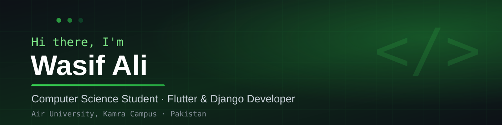
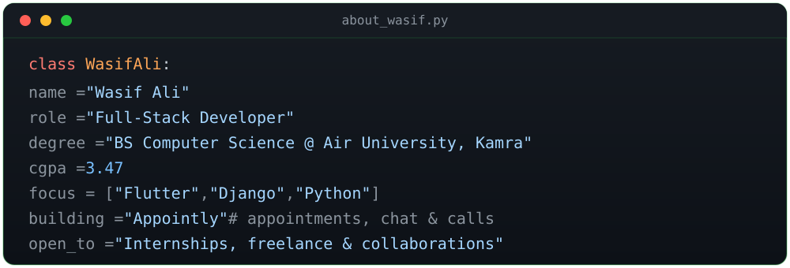
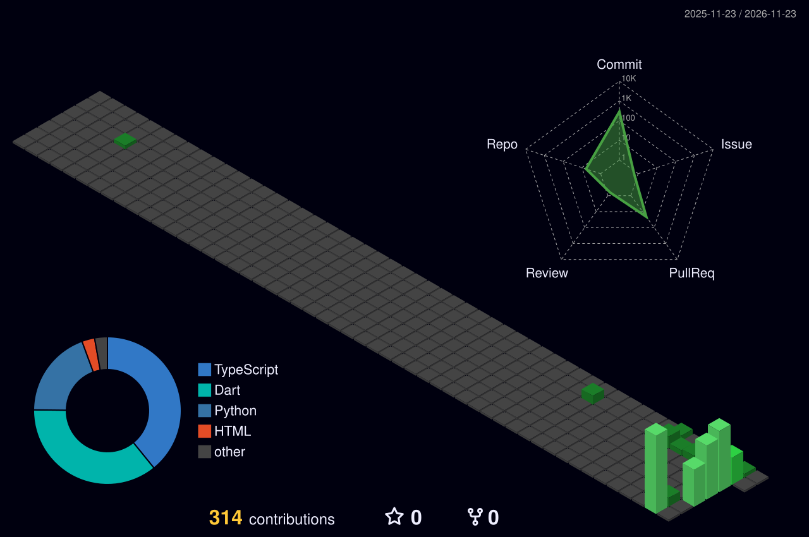

 

---

## About Me

I'm a Computer Science student in my 5th semester, building **Appointly** — an appointment-booking app with a Flutter frontend and a Django backend, including in-app chat and video calling. As **Director IT at OASIS Foundation**, I built and run the organisation's public website, and on **Fiverr** I offer professional Data Annotation services for AI/ML teams.

---

## Connect With Me

---

## Tech Stack & Skills

**Languages** 

  

**Web & Mobile** 

  

**Databases & Cloud** 

  

**Tools & Platforms** 

  

**Design** 

---

## GitHub Stats

 
 

 
 

---

## Education

| Degree | Institution | Semester | CGPA |
|:------:|:-----------:|:------:|:------:|
| BS Computer Science | Air University, Kamra Campus | 5th | 3.47 / 4.00 |
| Matric (Computer Science) | Faiza Inter College, Lahore Cantt | 2020–2022 | Grade A |

---

<h2 align="center">Certificates & Achievements</h2>

| Credential | Issuer | Date | Skills | Proof |
|:-----------|:-------|:-----|:-------|:------|
| C++: Algorithms | Codio via Coursera | Sep 2025 | C++ · Algorithms · DSA |  |
| Hands-On Data Annotation | LinkedIn Learning | Dec 2025 | Annotation · ML Data | — |
| Digital Marketing | Adobe via Coursera | Aug 2025 | Marketing · Google Ads |  |
| Create Your E-Commerce Store with Shopify | Coursera | Aug 2025 | E-Commerce · Shopify |  |
| Graphic Designing (Basic) | PAFWA Skills Development Centre | Jul 2025 | Photoshop · Illustrator · Canva | — |

🏆 President, Coding Arena'25 · 🎓 Class Representative, BS CS F'24 B · 🥇 Football & Badminton Gold Medalist

---

<h2 align="center">Recent Projects & Contributions</h2>

<table>
  <tr>
    <td width="24%" valign="top"> TypeScript</td>
    <td valign="top">My personal portfolio — Full-Stack Developer & CS undergraduate at Air University Kamra. Built with Next.js, live on Vercel.       · </td>
  </tr>
  <tr>
    <td width="24%" valign="top"> Dart · Flutter</td>
    <td valign="top">Appointly mobile app — appointment booking with in-app chat and WebRTC video calling.     </td>
  </tr>
  <tr>
    <td width="24%" valign="top"> Python · Django</td>
    <td valign="top">Appointly backend — Django + Django Channels powering auth, chat rooms and call signalling, with MongoDB.     </td>
  </tr>
  <tr>
    <td width="24%" valign="top"> HTML · CSS · JavaScript</td>
    <td valign="top">GoSafar — tours & travel website for northern Pakistan, with destinations, packages and WhatsApp booking.      · </td>
  </tr>
  <tr>
    <td width="24%" valign="top"> Coursework</td>
    <td valign="top">My university coursework, labs and assignments — including Full Stack Development labs and OOP/DSA projects.     </td>
  </tr>
</table>

<b>More projects</b>

 

<table>
  <tr>
    <td width="24%" valign="top"></td>
    <td valign="top">
      A graph-based adventure game in C++: DFS generates the maze, BFS finds the shortest path.  
      
    </td>
  </tr>
  <tr>
    <td valign="top"></td>
    <td valign="top">
      Desktop pharmacy system with role-based access (admin, seller, customer), MySQL inventory and real-time stock updates.  
      
    </td>
  </tr>
  <tr>
    <td valign="top"></td>
    <td valign="top">
      Blazor inventory system with role-based authorisation and synchronised stock state.  
      
    </td>
  </tr>
  <tr>
    <td valign="top"></td>
    <td valign="top">
      Role-based customer access portal: one MySQL database shared by four API-key roles, each with its own row limits, credits and visible fields — enforced on the server.  
      
    </td>
  </tr>
  <tr>
    <td valign="top"></td>
    <td valign="top">
      A Blazor task and appointment manager built during Visual Programming coursework.  
      
    </td>
  </tr>
</table>

---

<h2 align="center">What I'm Working On</h2>

<table>
  <tr><td>📱 Building Appointly — finishing chat & video call features</td></tr>
  <tr><td>🌐 Refining my portfolio at wasifportfolio-phi.vercel.app</td></tr>
  <tr><td>🏷️ Offering Data Annotation services on Fiverr for AI/ML teams</td></tr>
  <tr><td>💻 Leading tech at OASIS Foundation as Director IT</td></tr>
  <tr><td>📚 Deepening my backend skills with Django, REST APIs & MySQL</td></tr>
</table>

---

<h2 align="center">Fun Facts</h2>

> *Every app starts as a rough idea — I like turning ideas into something people can actually use.*
>
> *Flutter on the front, Django on the back, and chai in between.*
>
> *Goal: ship real products, not just assignments.*

---

⭐ **If you find my projects useful, consider giving them a star!** ⭐

